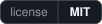
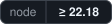
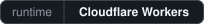
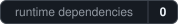
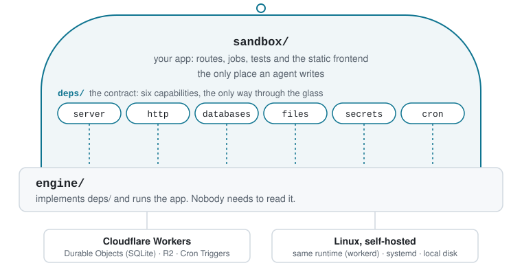

<!-- redoma:template-readme: this page presents the template. `npm run rename` replaces it with a starting README for your project, and from then on the file is yours. -->
<div align="center">

<picture>
  <source media="(prefers-color-scheme: dark)" srcset="engine/assets/logo-dark.svg">
  
</picture>

**A bell jar for your web server.**<br>
A TypeScript template for Cloudflare Workers and Linux, built to be driven by AI coding agents.

<a href="LICENSE"></a>
<a href="package.json"></a>
<a href="wrangler.jsonc"></a>
<a href="package.json"></a>

</div>

<br>

*Redoma* is Portuguese for a glass bell jar: everything inside is visible, and nothing gets in or out except through it. Your app lives under the jar, in `sandbox/`. It reaches the outside world only through six capabilities declared in `deps/`. An engine you never have to read implements them, on Cloudflare and on your own Linux machine alike.

### What you get

- **A contract an agent reads in a minute.** `deps/` is nine short files of types and examples. That is the whole API.
- **No setup, anywhere.** Databases appear on first use, cron needs no config, files and secrets are one call. Nothing to create in a dashboard, no identifiers to paste.
- **Two ways to publish.** Connect the repository in the Cloudflare dashboard and push, or run one command. Both are first-class.
- **The same app on your own server.** One command installs it as a Linux service with its data on local disk.
- **A lock you control.** `npm run restrict on` confines the app, and the agent, to `sandbox/`. Only a person at a terminal can turn it off.
- **Plain tools.** TypeScript end to end, no build step, no framework, no runtime dependencies. Node is the only prerequisite.

<br>

<p align="center">
<picture>
  <source media="(prefers-color-scheme: dark)" srcset="engine/assets/diagram-dark.svg">
  
</picture>
</p>

## Quickstart

You need [Node.js](https://nodejs.org) 22.18 or newer. Nothing else.

```bash
npm install
```

```bash
npm run rename my-app
```

```bash
npm run dev
```

Open the address it prints. You should see a small notes page that saves to a database. That page is the example app, in `sandbox/`.

> [!WARNING]
> The example has no login. Anyone who can reach a published copy can read and add notes. Add your own access control before you put anything private in it.

## Manual

Everything else is in **[REDOMA.md](REDOMA.md)**: the four folders, publishing to Cloudflare, secrets, updating the template, running on your own Linux server, restrict mode, known limitations and the full list of commands.

This `README.md` becomes yours: `npm run rename` swaps it for a short starting page for your project, and `npm run update` never touches it. The template keeps its manual in `REDOMA.md`.

## License

[MIT](LICENSE). The license covers the template. Your own app is yours: keep, replace or remove the file as you see fit.
